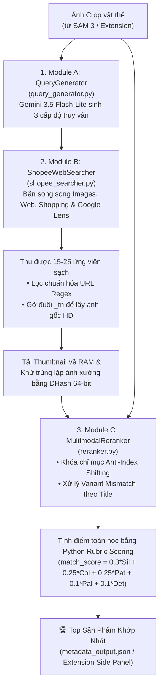

# TÀI LIỆU KIẾN TRÚC TÌM KIẾM SẢN PHẨM & ĐỐI CHIẾU THỊ GIÁC (GEMINI VLM & SERPER API)

> **Dự án**: TAP AI - Interactive Shoppable Media Engine  
> **Module**: Core Search & Multimodal Visual Reranker Pipeline

Tài liệu này tổng hợp toàn bộ danh sách các file mã nguồn, cấu trúc dữ liệu và cơ chế thuật toán tham gia trực tiếp vào quy trình: **Bóc tách ảnh vật thể $\rightarrow$ Sinh truy vấn VLM đa cấp độ $\rightarrow$ Quét sàn Shopee/Lazada qua Serper $\rightarrow$ Thẩm định trực quan & Tính điểm tương đồng bằng Rubric tất định**.

---

## 🗺️ 1. Sơ đồ luồng dữ liệu tổng quan (Pipeline Architecture)



---

## 📂 2. Danh mục toàn bộ các File Code đóng góp vào Pipeline

### 🧠 A. Bộ ba Module cốt lõi (Core Engine)

| Tên File | Đường dẫn | Vai trò chi tiết trong hệ thống |
| :--- | :--- | :--- |
| **`query_generator.py`** | [`backend/services/query_generator.py`](file:///c:/Users/THUTIN/Downloads/tap-ai-search/backend/services/query_generator.py) | **Module A (VLM Query Generator)**:<br/>• Cơ chế **Model Cascade Auto-Failover** tự động chuyển đổi giữa `GEMINI_MODEL`, `gemini-3.5-flash-lite`, `gemini-flash-lite-latest`, `gemini-3.8-flash` khi gặp 404/503.<br/>• Sinh đồng thời 3 cấp độ truy vấn: *Rộng (Broad)*, *Trending (Medium)*, *Chi tiết (Detailed)*.<br/>• Bản địa hóa từ vựng sàn TMĐT (*polo zip, ulzzang, form rộng, kẻ ngang...*) để triệt tiêu hoàn toàn bẫy Zero-Recall.<br/>• Loại bỏ bẫy suy biến âm thầm (Silent Fallback Trap), báo lỗi minh bạch. |
| **`shopee_searcher.py`** | [`backend/services/shopee_searcher.py`](file:///c:/Users/THUTIN/Downloads/tap-ai-search/backend/services/shopee_searcher.py) | **Module B (Serper Searcher & Scraper)**:<br/>• Gửi song song các truy vấn lên **Serper API** (`/images`, `/search`, `/shopping`, `/lens`).<br/>• Tăng `num=35` để bù trừ các trang danh mục rác bị loại bỏ.<br/>• Regex lọc sạch mọi biến thể link Shopee/Lazada và chuẩn hóa về link gốc.<br/>• Tự động xóa hậu tố `_tn` từ CDN Shopee để nâng cấp ảnh lên độ phân giải HD sắc nét. |
| **`reranker.py`** | [`backend/services/reranker.py`](file:///c:/Users/THUTIN/Downloads/tap-ai-search/backend/services/reranker.py) | **Module C (Multimodal VLM Reranker)**:<br/>• Cơ chế **Model Cascade Auto-Failover** chống lỗi 404/503, không giả mạo điểm số khi API gặp sự cố.<br/>• Băm thị giác DHash 64-bit trên RAM để loại bỏ ảnh trùng xưởng/Taobao giữa các shop.<br/>• Micro-batching tối đa 4 ứng viên/lượt để bảo toàn Attention của VLM.<br/>• Cơ chế Anti-Index Shifting đóng khung ID tường minh.<br/>• Xử lý lệch ảnh bìa phân loại (Variant Mismatch) dựa vào Tiêu đề sản phẩm.<br/>• Chấm điểm tất định 100% bằng hàm Python Rubric Scoring. |

---

### ⚙️ B. Bộ điều phối & Quản lý tác vụ (Orchestrator & Worker)

| Tên File | Đường dẫn | Vai trò chi tiết trong hệ thống |
| :--- | :--- | :--- |
| **`search_pipeline.py`** | [`backend/services/search_pipeline.py`](file:///c:/Users/THUTIN/Downloads/tap-ai-search/backend/services/search_pipeline.py) | **Nhạc trưởng điều phối (Pipeline Orchestrator)**:<br/>• Kết nối luồng hoàn chỉnh: Nhận ảnh $\rightarrow$ sinh truy vấn $\rightarrow$ quét sàn $\rightarrow$ đối chiếu thị giác $\rightarrow$ xuất danh sách Top $K$ sản phẩm.<br/>• Tự động nhận diện và chuyển giao `image_url` công khai sang Google Lens. |
| **`task_manager.py`** | [`backend/services/task_manager.py`](file:///c:/Users/THUTIN/Downloads/tap-ai-search/backend/services/task_manager.py) | **Quản lý hàng đợi nền (Async Background Task Manager)**:<br/>• Xử lý video batch dài mà không làm nghẽn HTTP request.<br/>• Cơ chế Deduplication thông minh: Gom nhóm các frame xuất hiện của cùng 1 vật thể, chọn đúng 1 frame rõ nhất ($W \times H \times \text{conf}$) để tìm kiếm 1 lần duy nhất.<br/>• Cung cấp API Polling tiến độ real-time (% hoàn thành & bước xử lý). |

---

### 📋 C. Cấu trúc dữ liệu & Data Contract

| Tên File | Đường dẫn | Vai trò chi tiết trong hệ thống |
| :--- | :--- | :--- |
| **`search_schemas.py` (models)** | [`backend/models/search_schemas.py`](file:///c:/Users/THUTIN/Downloads/tap-ai-search/backend/models/search_schemas.py) | **Pydantic Schemas**:<br/>• `EcomSearchQuery`: Chứa 3 cấp độ truy vấn đa tầng kèm validator đồng bộ fallback.<br/>• `ProductCandidate`: Chứa thông tin sản phẩm, link canonical, điểm số `match_score`, `rubric_breakdown`.<br/>• `TapAIMetadata`: Chuẩn định dạng `metadata.json` tích hợp cả Objects & Timeline. |
| **`search_schemas.py` (types)** | [`backend/types/search_schemas.py`](file:///c:/Users/THUTIN/Downloads/tap-ai-search/backend/types/search_schemas.py) | **Export Interface** phục vụ typing đồng bộ toàn bộ backend. |

---

### 🌐 D. Giao tiếp API & Server Entrypoint

| Tên File | Đường dẫn | Vai trò chi tiết trong hệ thống |
| :--- | :--- | :--- |
| **`search_routes.py`** | [`backend/routes/search_routes.py`](file:///c:/Users/THUTIN/Downloads/tap-ai-search/backend/routes/search_routes.py) | **API Router (`/api/v1`)**:<br/>• `POST /match-item`: Dành cho Chrome Extension (nhận Base64 / Image URL).<br/>• `POST /match-item/upload`: Upload file ảnh trực tiếp qua Swagger UI.<br/>• `POST /match-video-batch`: Tìm kiếm hàng loạt vật thể từ video ngầm.<br/>• `GET /image-proxy`: Proxy vượt rào cản CORS & Hotlinking của Shopee.<br/>• `GET /ranking-mode`: Trả về chế độ Pure Similarity Ranking. |
| **`main.py`** | [`backend/main.py`](file:///c:/Users/THUTIN/Downloads/tap-ai-search/backend/main.py) | **Entrypoint Server**:<br/>• Khởi tạo ứng dụng FastAPI, nạp cấu hình `.env`.<br/>• Khởi tạo sẵn `TapAISearchPipeline` vào `app.state.search_pipeline` qua Lifespan context.<br/>• Cấu hình CORS middleware cho phép Chrome Extension gọi trực tiếp. |

---

### 🧪 E. Bộ kịch bản kiểm thử tự động (Test Suite)

| Tên File | Đường dẫn | Vai trò chi tiết trong hệ thống |
| :--- | :--- | :--- |
| **`test_search_pipeline.py`** | [`backend/scripts/test_search_pipeline.py`](file:///c:/Users/THUTIN/Downloads/tap-ai-search/backend/scripts/test_search_pipeline.py) | **Kiểm thử E2E tích hợp**:<br/>• Đọc ảnh mẫu [`sample.jpg`](file:///c:/Users/THUTIN/Downloads/tap-ai-search/backend/scripts/test_images/sample.jpg) $\rightarrow$ gọi toàn bộ luồng AI Search $\rightarrow$ in ra kết quả Top 1 kèm lý do đánh giá $\rightarrow$ lưu file kết quả [`metadata_output.json`](file:///c:/Users/THUTIN/Downloads/tap-ai-search/backend/metadata_output.json). |
| **`test_reranker_ranking.py`** | [`backend/scripts/test_reranker_ranking.py`](file:///c:/Users/THUTIN/Downloads/tap-ai-search/backend/scripts/test_reranker_ranking.py) | **Unit test xếp hạng Rubric**:<br/>• Kiểm chứng tính điểm tất định của hàm `compute_rubric_score`: Mẫu giống 100% đạt 1.0, mẫu khác sọc đạt 0.65, mẫu sai phom dáng bị phạt xuống 0.15. |
| **`test_schema_and_cors.py`** | [`backend/scripts/test_schema_and_cors.py`](file:///c:/Users/THUTIN/Downloads/tap-ai-search/backend/scripts/test_schema_and_cors.py) | Kiểm thử schema hợp lệ và kiểm tra phản hồi CORS preflight OPTIONS với Chrome Extension. |

---

## 🎯 3. Các cơ chế thuật toán cốt lõi đã hoàn thiện

### A. Chiến lược Đa truy vấn song song (Parallel Multi-Query Expansion)
Gemini VLM sinh đồng thời 3 cấp độ trong 1 lần gọi duy nhất:
* **Cấp 1 - Rộng (`broad_query`)**: 2–3 từ (`"áo len polo"`). Bảo hiểm 100% không bị Zero-Recall.
* **Cấp 2 - Trending (`medium_query`)**: 3–5 từ (`"áo len polo zip kẻ ngang form rộng"`). Khớp thuật ngữ các shop đặt tiêu đề nhiều nhất.
* **Cấp 3 - Chi tiết (`detailed_query`)**: 5–7 từ (`"áo len polo zip kẻ sọc ngang trắng đen đỏ form rộng ulzzang"`).

### B. Công thức tính điểm Rubric tất định (Deterministic Scoring)
VLM không tự sinh điểm số thực (tránh sai số thả nổi). VLM chỉ gán các giá trị rời rạc (`EXACT`, `CLOSE`, `DIFFERENT`), sau đó hàm Python tính toán theo công thức cố định:

$$\text{match\_score} = 0.30 \times S_{\text{silhouette}} + 0.25 \times S_{\text{collar}} + 0.25 \times S_{\text{pattern}} + 0.10 \times S_{\text{color}} + 0.10 \times S_{\text{details}}$$

* **Phom dáng (Silhouette - 30%)**: Phom áo, tay dài/cộc. Nếu khác hẳn phom dáng, điểm trần bị ép $\le 0.15$.
* **Cổ áo & Khóa (Collar/Neckline - 25%)**: Cổ polo zip vs cổ tròn vs cúc cài.
* **Họa tiết (Pattern - 25%)**: Kẻ sọc ngang vs caro vs trơn đơn sắc.
* **Màu sắc & Biến thể (Color Palette - 10%)**: Phối màu chủ đạo.
* **Chi tiết điểm nhấn (Key Details - 10%)**: Khóa kéo kim loại, túi áo, bo gấu.

### C. Khử trùng lặp ảnh xưởng Taobao bằng DHash (Perceptual Hash)
* Chuyển thumbnail về grayscale $9 \times 8$, so sánh độ sáng các cặp điểm ảnh liền kề để tạo chuỗi băm 64-bit.
* Nếu khoảng cách Hamming giữa 2 ảnh $\le 4$ bit, hệ thống xem là cùng một ảnh chụp và chỉ giữ lại 1 sản phẩm có rank cao nhất, dành chỗ cho các mẫu thiết kế khác nhau.

### D. Xử lý lệch ảnh bìa phân loại hàng (Variant Mismatch)
* Nếu ảnh bìa hiển thị màu đơn sắc nhưng `Title` chứa các từ khóa chỉ họa tiết/màu của ảnh mục tiêu (`kẻ ngang`, `sọc kẻ`, `phối màu`), VLM sẽ đánh giá `pattern_match` hoặc `color_palette_match` là `CLOSE`/`EXACT` thay vì trừ điểm oan.

---

## 🚀 4. Lệnh chạy kiểm thử nhanh

Mở PowerShell tại thư mục gốc của dự án và chạy:

```powershell
# 1. Kiểm tra thuật toán Rubric tính điểm tất định
.\venv\Scripts\python.exe backend\scripts\test_reranker_ranking.py

# 2. Kiểm tra Schema Data Contract & CORS
.\venv\Scripts\python.exe backend\scripts\test_schema_and_cors.py

# 3. Chạy toàn diện luồng tìm kiếm AI thực tế (Gemini + Serper + Rerank)
$env:PYTHONPATH="backend"
.\venv\Scripts\python.exe backend\scripts\test_search_pipeline.py
```
